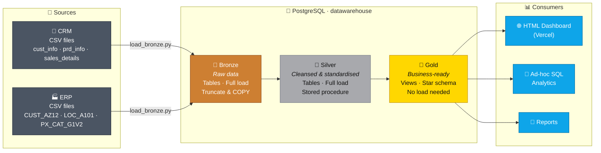
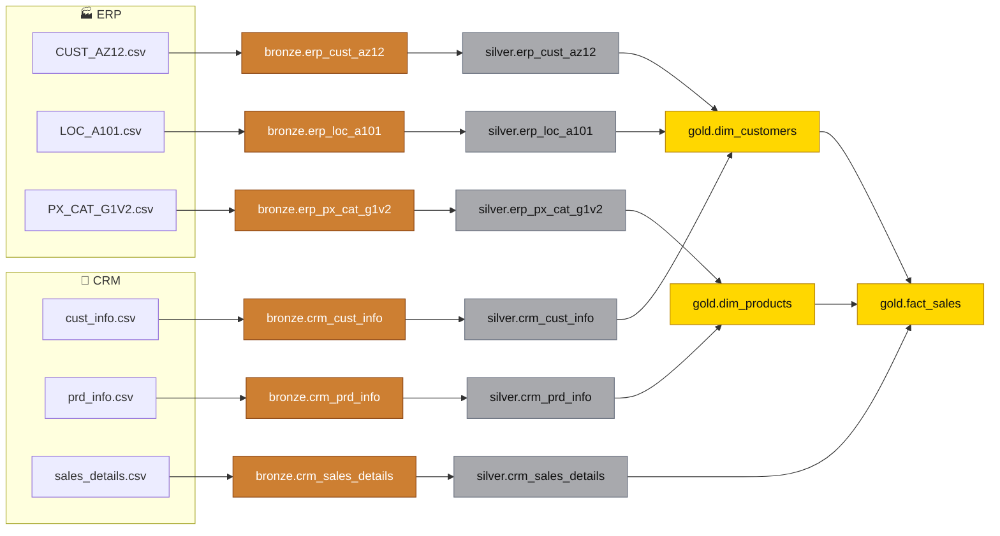
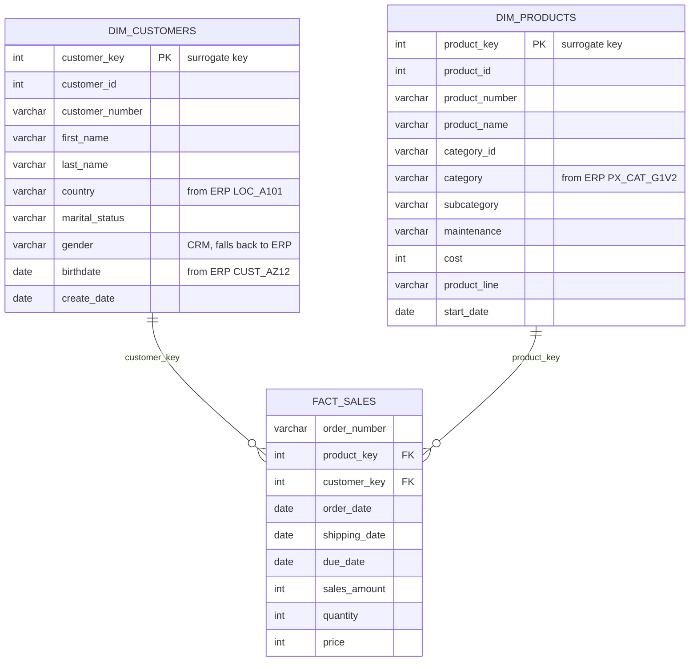

<div align="center">

# 🏛️ SQL Data Warehouse & Analytics Project

**An end-to-end data warehouse built on PostgreSQL using the Medallion Architecture — from raw CRM/ERP CSV files to a business-ready star schema and an interactive analytics dashboard.**

<br/>


<br/>

### 📊 [**➜ View the Live Analytics Dashboard**](https://sql-data-analytics-project.vercel.app/)

[](https://sql-data-analytics-project.vercel.app/)

</div>

---

## 📑 Table of Contents

- [📖 Project Overview](#-project-overview)
- [📊 Live Dashboard (HTML)](#-live-dashboard-html)
- [🏗️ Data Architecture](#️-data-architecture)
- [🔄 Data Flow & ETL Pipeline](#-data-flow--etl-pipeline)
- [⭐ Data Model (Star Schema)](#-data-model-star-schema)
- [🧹 Data Cleansing Rules (Silver Layer)](#-data-cleansing-rules-silver-layer)
- [✅ Data Quality Checks](#-data-quality-checks)
- [📂 Repository Structure](#-repository-structure)
- [⚙️ Getting Started](#️-getting-started)
- [🚀 Project Requirements](#-project-requirements)
- [📜 License](#-license)

---

## 📖 Project Overview

This project demonstrates a comprehensive **data warehousing and analytics solution** — from ingesting raw source files to generating actionable business insights. It is designed as a portfolio project that follows industry best practices in data engineering and analytics.

| # | Area | What it involves |
|:-:|------|------------------|
| 1️⃣ |  | Designing a modern data warehouse using the Medallion Architecture (**Bronze → Silver → Gold**). |
| 2️⃣ |  | Extracting, transforming and loading data from two source systems (CRM & ERP) into the warehouse. |
| 3️⃣ |  | Building fact and dimension tables (star schema) optimised for analytical queries. |
| 4️⃣ |  | SQL-based analytics and an interactive HTML dashboard delivering business insights. |

---

## 📊 Live Dashboard (HTML)

> [!TIP]
> 🌐 **Dashboard link:** **https://sql-data-analytics-project.vercel.app/**
>
> An interactive dashboard built in **HTML** and deployed on **Vercel**, powered by the Gold layer of this warehouse.

The dashboard turns the Gold-layer star schema into visual, explorable insights:

| Section | What you'll find |
|---------|------------------|
| 🏠 **Overview** | KPI cards (total revenue, orders, customers, average order value, unique products, gross margin) with year-over-year change, annual revenue trend, category split and monthly revenue trend. |
| 🔎 **Database Exploration** | Row counts per fact/dimension table, date coverage, column completeness, descriptive statistics of sales amounts and cardinality of key columns. |
| 📈 **Time Series** | Month-over-month changes, year-over-year comparison, running totals, YTD revenue and 3/6-month moving averages. |
| 🧠 **Analytics** | Product performance ranking, RFM customer segmentation, spend bands, lifecycle stages and part-to-whole (category / territory) analysis. |
| 👥 **Customer Report** | Customer lifespan, lifetime value, average monthly revenue, orders per customer and top customers by country. |
| 📦 **Product Report** | Product count, gross margin by category, best-margin subcategory, units sold and a detailed product table. |

---

## 🏗️ Data Architecture

The warehouse follows the **Medallion Architecture** with three layers — **Bronze**, **Silver** and **Gold** — each implemented as its own PostgreSQL schema inside the `datawarehouse` database.



| Layer | Object type | Load method | Transformations | Data model | Audience |
|:-----:|-------------|-------------|-----------------|------------|----------|
|  | Tables | Full load (truncate + `COPY`) | None — data stored **as-is** | None (as-is) | Data engineers |
|  | Tables | Full load (stored procedure `silver.load_silver()`) | Cleansing, standardisation, normalisation, derived columns, enrichment | None (as-is) | Data engineers, analysts |
|  | Views | No load | Data integration, aggregation, business logic | Star schema | Analysts, BI, business users |

1. **🥉 Bronze Layer** — Stores raw data exactly as it arrives from the source systems. The Python loader (`scripts/bronze/load_bronze.py`) truncates each table, bulk-loads the CSV with PostgreSQL `COPY`, counts the rows and writes a success/failure entry to an ETL log table.
2. **🥈 Silver Layer** — Cleanses and standardises the bronze data: trims whitespace, removes duplicates, decodes abbreviations, fixes invalid dates and recomputes inconsistent sales values. Implemented in the PL/pgSQL procedure `silver.load_silver()`, which logs the load duration of every table.
3. **🥇 Gold Layer** — Integrates CRM and ERP data into business-friendly **views** modelled as a star schema (`dim_customers`, `dim_products`, `fact_sales`), ready for reporting and the dashboard.

---

## 🔄 Data Flow & ETL Pipeline

The diagram below shows the lineage of every table — how each source file travels through the layers.



### 📥 Source systems

| Source | File | Bronze table | Description | Rows* |
|:------:|------|--------------|-------------|------:|
|  | `cust_info.csv` | `bronze.crm_cust_info` | Customer master data (name, marital status, gender, create date) | ~18.5K |
|  | `prd_info.csv` | `bronze.crm_prd_info` | Product master with cost, product line and validity dates (historised) | ~400 |
|  | `sales_details.csv` | `bronze.crm_sales_details` | Sales order lines (order/ship/due dates, quantity, price, amount) | ~60.4K |
|  | `CUST_AZ12.csv` | `bronze.erp_cust_az12` | Extra customer attributes: birthdate & gender | ~18.5K |
|  | `LOC_A101.csv` | `bronze.erp_loc_a101` | Customer country / location | ~18.5K |
|  | `PX_CAT_G1V2.csv` | `bronze.erp_px_cat_g1v2` | Product category, subcategory and maintenance flag | 37 |

<sub>* Approximate line counts of the CSV files, including the header.</sub>

---

## ⭐ Data Model (Star Schema)

The Gold layer is a **star schema** with one fact view surrounded by two dimension views. Surrogate keys (`customer_key`, `product_key`) are generated with `ROW_NUMBER()`.



<details>
<summary><b>🔍 Click to see how each Gold view is built</b></summary>

<br/>

- **`gold.dim_customers`** — `silver.crm_cust_info` is the master; it is `LEFT JOIN`ed to `silver.erp_cust_az12` (birthdate, gender) and `silver.erp_loc_a101` (country) on the customer key. Gender comes from CRM, and falls back to ERP when CRM has `'n/a'`.
- **`gold.dim_products`** — `silver.crm_prd_info` joined to `silver.erp_px_cat_g1v2` on `cat_id` for category data. Only **current** products are kept (`prd_end_dt IS NULL`), so historical versions are filtered out.
- **`gold.fact_sales`** — `silver.crm_sales_details` joined to both dimensions to replace business keys with surrogate keys.

📘 Full column-level documentation is in the **[Data Catalog](docs/data_catalog.md)**.

</details>

---

## 🧹 Data Cleansing Rules (Silver Layer)

<details>
<summary><b>🧾 CRM tables — click to expand</b></summary>

<br/>

| Table | Rule |
|-------|------|
| `crm_cust_info` | Remove rows with `NULL` `cst_id`; **deduplicate** by keeping the latest record per customer (`ROW_NUMBER() ... ORDER BY cst_create_date DESC`) |
| `crm_cust_info` | `TRIM` first/last names |
| `crm_cust_info` | Decode marital status `S/M` → `Single/Married`, gender `F/M` → `Female/Male`, anything else → `n/a` |
| `crm_prd_info` | Derive `cat_id` from the first 5 chars of `prd_key` (`-` → `_`) and strip it from `prd_key` |
| `crm_prd_info` | Replace `NULL` cost with `0`; decode product line `M/R/S/T` → `Mountain/Road/Other Sales/Touring` |
| `crm_prd_info` | Rebuild `prd_end_dt` as *next start date − 1 day* using `LEAD()` (fixes overlapping validity periods) |
| `crm_sales_details` | Convert integer dates `YYYYMMDD` → `DATE`; invalid values (`0` or wrong length) → `NULL` |
| `crm_sales_details` | If sales is missing, ≤ 0, or ≠ `quantity × price`, recompute it as `quantity × ABS(price)` |
| `crm_sales_details` | If price is missing or ≤ 0, derive it as `sales / quantity` |

</details>

<details>
<summary><b>🏭 ERP tables — click to expand</b></summary>

<br/>

| Table | Rule |
|-------|------|
| `erp_cust_az12` | Strip the `NAS` prefix from `cid` so it matches the CRM customer key |
| `erp_cust_az12` | Birthdates in the future → `NULL` |
| `erp_cust_az12` | Normalise gender (`F`, `FEMALE`, `M`, `MALE`) → `Female/Male`, others → `n/a` |
| `erp_loc_a101` | Remove `-` from `cid` |
| `erp_loc_a101` | Normalise country codes: `DE` → `Germany`, `US/USA` → `United States`, blank → `n/a` |
| `erp_px_cat_g1v2` | Loaded as-is (already clean) |

</details>

---

## ✅ Data Quality Checks

Quality checks live in the [`test/`](test/) folder and should return **no rows** when the data is healthy.

| Script | Layer | Checks |
|--------|:-----:|--------|
| [`quality_check_silver.sql`](test/quality_check_silver.sql) |  | Nulls/duplicates in primary keys, unwanted spaces, standardisation of coded values, invalid date ranges & orders, sales = quantity × price consistency |
| [`quality_check_gold.sql`](test/quality_check_gold.sql) |  | Uniqueness of surrogate keys in dimensions and referential integrity between `fact_sales` and its dimensions |

---

## 📂 Repository Structure

```
sql-data-warehouse-project/
│
├── 📁 datasets/                      # Raw source data (CSV)
│   ├── source_crm/                   # cust_info, prd_info, sales_details
│   └── source_erp/                   # CUST_AZ12, LOC_A101, PX_CAT_G1V2
│
├── 📁 docs/
│   ├── data_architecture.png         # Original architecture image
│   └── data_catalog.md               # Gold layer data dictionary
│
├── 📁 scripts/
│   ├── init_database.sql             # Creates database + bronze/silver/gold schemas
│   ├── bronze/
│   │   ├── load_bronze.py            # Python loader: CSV → bronze (COPY + ETL logging)
│   │   └── requirements.txt          # psycopg2-binary, python-dotenv
│   ├── silver/
│   │   ├── ddl_silver.sql            # Silver table definitions
│   │   └── proc_load_silver.sql      # silver.load_silver() cleansing procedure
│   └── gold/
│       └── ddl_gold.sql              # Star schema views
│
├── 📁 test/
│   ├── quality_check_silver.sql
│   └── quality_check_gold.sql
│
├── LICENSE
└── README.md
```

---

## ⚙️ Getting Started

<details open>
<summary><b>🛠️ Step-by-step setup</b></summary>

<br/>

**Prerequisites:**  

**1. Clone the repository**

```bash
git clone https://github.com/anurag-23werty/sql-data-warehouse-project.git
cd sql-data-warehouse-project
```

**2. Create the database and schemas**

```bash
psql -U postgres -f scripts/init_database.sql
```

**3. Configure database credentials** — create a `.env` file for the Python loader:

```env
DB_HOST=localhost
DB_PORT=5432
DB_NAME=datawarehouse
DB_USER=postgres
DB_PASSWORD=your_password
```

**4. Load the Bronze layer** (bronze tables and the `public.etl_log` table must exist first)

```bash
pip install -r scripts/bronze/requirements.txt
python scripts/bronze/load_bronze.py
```

**5. Build and load the Silver layer**

```sql
\i scripts/silver/ddl_silver.sql
\i scripts/silver/proc_load_silver.sql
CALL silver.load_silver();
```

**6. Create the Gold layer views**

```sql
\i scripts/gold/ddl_gold.sql
```

**7. Validate**

```sql
\i test/quality_check_silver.sql
\i test/quality_check_gold.sql
```

**8. Explore** — query the `gold` schema, or open the [**live dashboard**](https://sql-data-analytics-project.vercel.app/) 🎉

</details>

---

## 🚀 Project Requirements

### 🛠️ Building the Data Warehouse (Data Engineering)


Develop a modern data warehouse using **PostgreSQL** to consolidate sales data, enabling analytical reporting and informed decision-making.

| Specification | Details |
|---------------|---------|
| 📥 **Data Sources** | Import data from two source systems (ERP and CRM) provided as CSV files. |
| 🧹 **Data Quality** | Cleanse and resolve data quality issues prior to analysis. |
| 🔗 **Integration** | Combine both sources into a single, user-friendly data model designed for analytical queries. |
| 🎯 **Scope** | Focus on the latest dataset only; historisation of data is not required. |
| 📘 **Documentation** | Provide clear documentation of the data model to support both business stakeholders and analytics teams. |

### 📊 BI: Analytics & Reporting (Data Analysis)


Develop SQL-based analytics to deliver detailed insights into:

-  — who buys, how often, and how valuable they are
-  — which products and categories drive revenue and margin
-  — how revenue changes over months and years

These insights give stakeholders key business metrics for strategic decision-making — all visualised in the **[HTML dashboard](https://sql-data-analytics-project.vercel.app/)**.

---

## 📜 License

This project is licensed under the **MIT License** — see the [LICENSE](LICENSE) file for details.

<div align="center">

<br/>

⭐ **If you found this project useful, consider giving it a star!** ⭐

</div>
